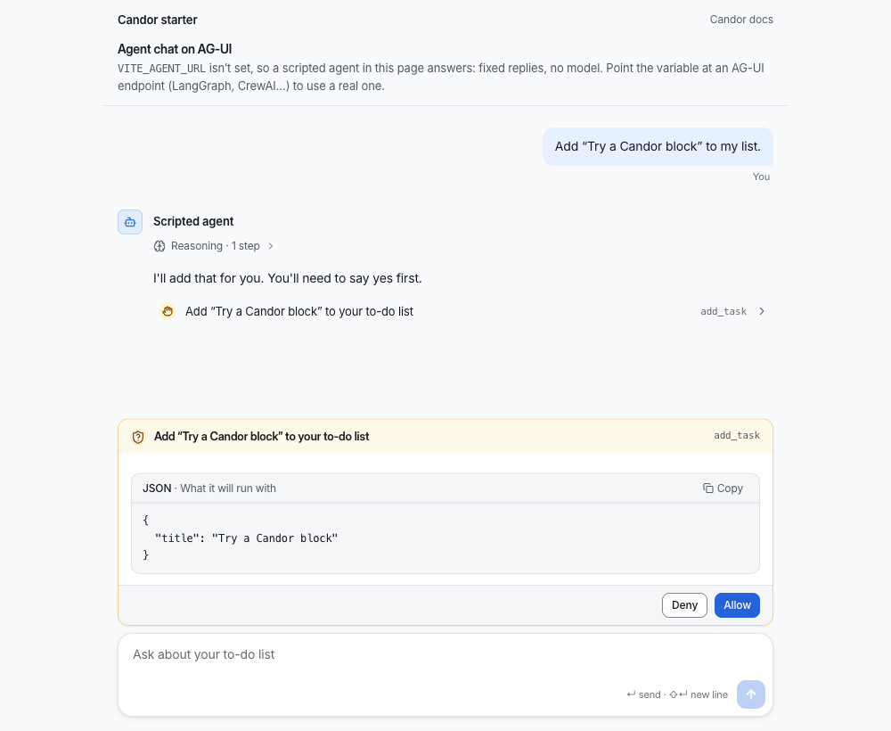

# Candor UI: the free tier

**Honest agent UI for shadcn/ui:** chat, tool calls and permission prompts that never overstate what an agent did. MIT.

[](https://github.com/MethodicDev/candor/actions/workflows/starters.yml)
[](https://www.npmjs.com/package/candor-ui)
[](LICENSE)
[](https://github.com/MethodicDev/candor/releases)



**[Try the app demo](https://candor.themethodic.com/app)** · **[Honest against typical, side by side](https://candor.themethodic.com/honest-vs-typical)** · [Docs](https://candor.themethodic.com/docs) · [Changelog](https://candor.themethodic.com/changelog)

Interface components for agent apps: a thread, messages, a composer, tool calls, reasoning and citations, the
building blocks under them, a light, dark and high-contrast theme, and adapters for the Vercel AI SDK, the Claude
Agent SDK and AG-UI. For shadcn/ui projects, installed with the `candor-ui` CLI or shadcn's own, MIT licensed.

This repo is the source of Candor UI's 73 free items (version 4.0.0), the skill and plugins for coding
agents and 3 starter apps. Docs and live examples: **https://candor.themethodic.com**.

The same free items are on npm as [`@candor-ui/react`](https://www.npmjs.com/package/@candor-ui/react), for people who
would rather `npm install` than copy code in. That package changes only when a free item changes, so its version can be
behind the kit's after a release that changed only Pro items; the CLI, `candor-ui`, has a version of its own. The
[changelog](https://candor.themethodic.com/changelog) says which release changed what.

## Try it in a minute, no key

```bash
npx degit MethodicDev/candor/starter-vite-ag-ui my-app
cd my-app
npm install
npm run dev
```

Open the address it prints. A scripted agent answers in the page: fixed replies, no model, no server and no API key,
and the page says so. Ask it to add "Try a Candor block" to your list and you'll see a line of its reasoning, a tool
call marked "Needs you", and a permission prompt that shows what it will run, with Deny and Allow and neither
chosen for you. That is what the image above shows. Point `VITE_AGENT_URL` at an AG-UI agent (LangGraph, CrewAI…)
when you want a real one.

## Why Candor

An agent that acts on real systems can mislead without saying anything false: a spinner nobody has heard from, a total
that treats a missing cost as zero, an approval that now applies to a different change. Candor's components keep these
9 rules. Where [Honest against typical](https://candor.themethodic.com/honest-vs-typical) has a moment that shows one, the link goes to its
Typical and Honest switch; the others go to [Principles](https://candor.themethodic.com/principles).

- **[Model output is text, never markup](https://candor.themethodic.com/honest-vs-typical#link-the-model-wrote)**: Adapters read what a model writes as a small safe subset of markdown; a link becomes plain text with its address beside it.
- **[Unknown stays unknown](https://candor.themethodic.com/honest-vs-typical#run-that-went-quiet)**: A cost or duration the service didn't report reads “not measured”, not zero, and an estimate says it is one.
- **[A control that can't be used says why](https://candor.themethodic.com/honest-vs-typical#button-that-was-dead)**: A control that can't be used carries its reason, on hover and focus and to screen readers.
- **[Nothing is pre-selected in a decision](https://candor.themethodic.com/honest-vs-typical#approve-already-chosen)**: Approve and reject, allow and deny start with neither chosen.
- **[Approve the exact change](https://candor.themethodic.com/honest-vs-typical#approval-that-moved)**: A decision is tied to a hash of the change that was asked about; a change that moved since is refused.
- **[Reasoning is believed, not verified](https://candor.themethodic.com/principles#reasoning-is-believed)**: Reasoning is shown as the model's own account and marked as unchecked; evidence is shown as evidence.
- **[The agent is always named, by the app](https://candor.themethodic.com/principles#agents-are-named)**: Every agent message names its agent from the app's data, never from model output.
- **[Say what can and can't be undone](https://candor.themethodic.com/honest-vs-typical#restore-that-missed-a-shell-change)**: Destructive actions say what they remove and whether it can be brought back.
- **[Motion follows the outcome](https://candor.themethodic.com/honest-vs-typical#tick-before-the-clipboard-answered)**: A success mark is drawn after the result settles; motion reports a change and never predicts one.

## Install

```bash
npx candor-ui@latest init
npx candor-ui add thread message composer
```

`candor-ui init` adds the `@candor` registry to `components.json` and the theme to your CSS; in a project without
shadcn yet it runs shadcn's setup first (`--yes` sets it up with Radix and shadcn's nova preset, no questions). Or add the registry by
hand: `"@candor": "https://candor.themethodic.com/r/{name}.json"`. If shadcn asks to overwrite a primitive such as
`ui/button.tsx`, answer yes: Candor's button styles locked actions; without a terminal, pass `--overwrite`.

### Or from npm

```bash
npm install @candor-ui/react
```

```tsx
import { Thread, Message, Composer } from "@candor-ui/react"
```

Then `@import "@candor-ui/react/styles.css"` after Tailwind. The package holds the free tier only, and its version can be
behind the kit's; its [README](https://www.npmjs.com/package/@candor-ui/react) has the adapters and the entry points.

## Tools

`candor-ui` also checks what you build, from the CLI's own docs:

- **`lint`** checks your `.tsx`, `.ts`, `.jsx` and `.js` files against Candor's honesty rules and prints
  `path:line:col  rule  message` for each finding; it exits 1 on an error.
- **`audit`** is `lint` plus a look at a running page: `npx candor-ui audit http://localhost:3000` runs axe and the
  honesty rules on it and writes `AUDIT.md`.
- **`update`** moves installed items to the latest version and keeps your changes: a file you edited gets a three-way
  merge, and where you and we changed the same lines it writes conflict markers.
- **`verify`** is for CI: it checks `candor-lock.json` against the registry's versioned snapshots and the files on disk.
- **`theme check`** checks your theme's colour contrast and its motion and sound values, and changes nothing.

`candor-ui doctor` explains an install that looks wrong. Every command is in the
[CLI's README](https://www.npmjs.com/package/candor-ui).

## For coding agents

`llms-install.md` tells an agent how to set Candor up in a project by itself: the CLI, the docs MCP server, the skill
and the honesty rules to keep. The skill alone:

```bash
npx skills add MethodicDev/candor
```

installs two skills: `skills/candor-ui` (which component fits which job, the adapters, and the rules the components
keep, with a design-system reference read from the shipped CSS) and `skills/candor-agent-ui` (design fundamentals for
screens where an AI agent acts, with a review checklist to run after each screen; it works with or without Candor).

The plugins install the skill and the docs MCP server together. Claude Code: `claude plugin marketplace add
MethodicDev/candor`, then `claude plugin install candor-ui@candor` (or, in a session,
`/plugin install candor-ui --marketplace MethodicDev/candor`). GitHub Copilot CLI: `copilot plugin marketplace add
MethodicDev/candor`, then `copilot plugin install candor-ui@candor`. VS Code installs `candor-ui` from this repo's URL;
Cursor reads `.cursor-plugin/marketplace.json`; the Codex package is `plugins/codex/candor-ui`.

The MCP server at https://candor.themethodic.com/mcp serves docs and component suggestions only: read-only, no key,
never paid source. `.mcp/server.json` describes it for the MCP registry. Agents can also read
https://candor.themethodic.com/llms.txt.

## Starters

Starter apps with a working agent chat built from these components (3 of them). Each installs and builds on its own:

| Folder | Stack | Agent |
|---|---|---|
| `starter-vite-ag-ui/` | Vite and React, no server | a scripted one in the page (no key; see above), or any AG-UI agent (LangGraph, CrewAI…) |
| `starter/` | Next.js 16 | Vercel AI SDK at `/`, Claude Agent SDK at `/claude` (needs an Anthropic API key) |
| `starter-tanstack-start-claude/` | TanStack Start | Claude Agent SDK (needs an Anthropic API key) |

```bash
npx degit MethodicDev/candor/starter-vite-ag-ui my-agent-app
npx degit MethodicDev/candor/starter my-agent-app
npx degit MethodicDev/candor/starter-tanstack-start-claude my-agent-app
```

## What's here

73 free items, each with a docs page that has its props and live examples. Install any of them by name:
`npx candor-ui add <name>`.

| Area | What it's for | Items |
|---|---|---|
| **Chat** (20) | A conversation with an agent: messages, the composer, tool calls, reasoning, citations. | [`agent-avatar`](https://candor.themethodic.com/docs/agent-avatar), [`ai-disclosure`](https://candor.themethodic.com/docs/ai-disclosure), [`attachment-preview`](https://candor.themethodic.com/docs/attachment-preview), [`card-registry`](https://candor.themethodic.com/docs/card-registry), [`citation`](https://candor.themethodic.com/docs/citation), [`composer`](https://candor.themethodic.com/docs/composer), [`context-meter`](https://candor.themethodic.com/docs/context-meter), [`entity-chip`](https://candor.themethodic.com/docs/entity-chip), [`folded-turns`](https://candor.themethodic.com/docs/folded-turns), [`message-actions`](https://candor.themethodic.com/docs/message-actions), [`message-content`](https://candor.themethodic.com/docs/message-content), [`message`](https://candor.themethodic.com/docs/message), [`payload`](https://candor.themethodic.com/docs/payload), [`permission-prompt`](https://candor.themethodic.com/docs/permission-prompt), [`prompt-suggestions`](https://candor.themethodic.com/docs/prompt-suggestions), [`reasoning`](https://candor.themethodic.com/docs/reasoning), [`thread-divider`](https://candor.themethodic.com/docs/thread-divider), [`thread-event`](https://candor.themethodic.com/docs/thread-event), [`thread`](https://candor.themethodic.com/docs/thread), [`tool-call`](https://candor.themethodic.com/docs/tool-call) |
| **Adapters** (7) | Map an agent SDK's messages onto Candor's data: the Vercel AI SDK, the Claude Agent SDK and AG-UI. | [`ag-ui`](https://candor.themethodic.com/docs/ag-ui), [`ai-sdk`](https://candor.themethodic.com/docs/ai-sdk), [`claude-agent-sdk`](https://candor.themethodic.com/docs/claude-agent-sdk), [`claude-agent-server`](https://candor.themethodic.com/docs/claude-agent-server), [`use-ag-ui`](https://candor.themethodic.com/docs/use-ag-ui), [`use-candor-chat`](https://candor.themethodic.com/docs/use-candor-chat), [`use-claude-agent`](https://candor.themethodic.com/docs/use-claude-agent) |
| **Building blocks** (7) | Small pieces every screen uses: locked controls, status dots, step lists, relative times. | [`copy-field`](https://candor.themethodic.com/docs/copy-field), [`degraded-panel`](https://candor.themethodic.com/docs/degraded-panel), [`relative-time`](https://candor.themethodic.com/docs/relative-time), [`status-dot`](https://candor.themethodic.com/docs/status-dot), [`step-list`](https://candor.themethodic.com/docs/step-list), [`streaming-text`](https://candor.themethodic.com/docs/streaming-text), [`surface`](https://candor.themethodic.com/docs/surface) |
| **App shell** (2) | The app around the agent: layout, sidebar, command menu, sessions, notices. | [`page-header`](https://candor.themethodic.com/docs/page-header), [`page-state`](https://candor.themethodic.com/docs/page-state) |
| **Primitives** (13) | The shadcn/ui primitives Candor's components are built on. | [`accordion`](https://candor.themethodic.com/docs/accordion), [`alert`](https://candor.themethodic.com/docs/alert), [`button`](https://candor.themethodic.com/docs/button), [`checkbox`](https://candor.themethodic.com/docs/checkbox), [`collapsible`](https://candor.themethodic.com/docs/collapsible), [`label`](https://candor.themethodic.com/docs/label), [`locked`](https://candor.themethodic.com/docs/locked), [`popover`](https://candor.themethodic.com/docs/popover), [`progress`](https://candor.themethodic.com/docs/progress), [`skeleton`](https://candor.themethodic.com/docs/skeleton), [`slider`](https://candor.themethodic.com/docs/slider), [`switch`](https://candor.themethodic.com/docs/switch), [`tooltip`](https://candor.themethodic.com/docs/tooltip) |
| **Themes** (6) | The default theme and 5 gallery themes: colours, type, radius and motion as CSS variables, in light, dark and high contrast. | [`tokens`](https://candor.themethodic.com/docs/tokens), [`theme`](https://candor.themethodic.com/docs/theme), [`theme-slate`](https://candor.themethodic.com/docs/theme-slate), [`theme-paper`](https://candor.themethodic.com/docs/theme-paper), [`theme-console`](https://candor.themethodic.com/docs/theme-console), [`theme-signal`](https://candor.themethodic.com/docs/theme-signal) |

<details>
<summary>Shared helpers and fonts (18)</summary>

**Shared types and helpers** (15): Types and pure functions the components share.

[`chat`](https://candor.themethodic.com/docs/chat), [`fill-strings`](https://candor.themethodic.com/docs/fill-strings), [`format-elapsed`](https://candor.themethodic.com/docs/format-elapsed), [`highlight`](https://candor.themethodic.com/docs/highlight), [`know`](https://candor.themethodic.com/docs/know), [`layer`](https://candor.themethodic.com/docs/layer), [`locale`](https://candor.themethodic.com/docs/locale), [`mcp-input`](https://candor.themethodic.com/docs/mcp-input), [`motion`](https://candor.themethodic.com/docs/motion), [`safe-markdown`](https://candor.themethodic.com/docs/safe-markdown), [`sound`](https://candor.themethodic.com/docs/sound), [`status`](https://candor.themethodic.com/docs/status), [`use-copy`](https://candor.themethodic.com/docs/use-copy), [`use-shortcut`](https://candor.themethodic.com/docs/use-shortcut), [`use-virtual-list`](https://candor.themethodic.com/docs/use-virtual-list)

**Fonts** (3): Self-hosted, and optional: without one the theme uses the system font.

[`font-inter`](https://candor.themethodic.com/docs/font-inter), [`font-source-sans`](https://candor.themethodic.com/docs/font-source-sans), [`font-ibm-plex`](https://candor.themethodic.com/docs/font-ibm-plex)

</details>

## Pro, Premium and Team

One-time prices, no subscription. A licence includes every version Candor UI publishes, major ones included. You can
ask for a full refund within 30 days of buying. The free tier here is MIT.

| Tier | Price | What's in it | Support |
|---|---|---|---|
| Free (this repo) | $0, MIT | 73 items: the chat core, building blocks, themes, adapters; 3 starters; the skill and plugins | public issues here |
| Pro | $149, one person | All 293 items, the free ones included: the app shell, plans, approvals, diffs, runs, evals and admin | none; the docs and examples |
| Premium | $249, one person | Pro, plus 11 full-stack blocks and 4 templates, each for the Vercel AI SDK and the Claude Agent SDK | email, best effort |
| Team | $999, up to 10 people in one company | Premium | email, a first reply within 2 business days |

Buy at https://candor.themethodic.com/#pricing. The terms are the [Candor UI Commercial Licence](https://candor.themethodic.com/licence); [SUPPORT.md](.github/SUPPORT.md)
repeats the support each tier includes. Your key arrives in Polar's receipt email and customer portal; https://candor.themethodic.com/licence-key
says where, and what a refund does to it. Then, in your project:

```bash
npx candor-ui key <your licence key>   # saves it to .env.local, checks it, and has the registry send it
npx candor-ui add approval-request     # a Pro item, installed like any other
```

In CI, set `CANDOR_LICENSE_KEY` as a secret, so installs and `npx candor-ui verify` can read paid items. Installed code
needs no key to run; the key is only for installing and updating. Never put a key in an issue, a pull request or a
repository.

## How this repository works

- **The source of truth is private.** Candor UI's main repository holds the free items and the paid tiers together. This
  repository is generated from it on each release, so a change made here by hand would be overwritten.
- **From 2.6.2, each release is a commit, a tag and a GitHub Release.** The commit `Candor X.Y.Z`, the tag `vX.Y.Z` and the
  [release](https://github.com/MethodicDev/candor/releases) all carry that version's changelog section.
- **Issues are read.** Use the [forms](https://github.com/MethodicDev/candor/issues/new/choose). There is no promised reply time for the free tier; the
  support each paid tier includes is in [SUPPORT.md](.github/SUPPORT.md). A vulnerability goes to
  [SECURITY.md](.github/SECURITY.md), not to an issue.
- **A pull request isn't merged here.** If it is accepted, it is applied upstream by hand, credited in that release's
  changelog entry, and closed with a link to the release that holds it. [CONTRIBUTING.md](.github/CONTRIBUTING.md) has the
  rest.
- **Every release is reviewed over its full diff** by a separate review session that had no part in writing it, before
  the owner approves the merge. Most of the code is written with AI coding assistants, and the commits here say so in a
  Co-Authored-By line.

## Licence

MIT, © Methodic LLC. See `LICENSE`. It covers this repository's free items; Candor UI's paid items are under the
[Candor UI Commercial Licence](https://candor.themethodic.com/licence).
